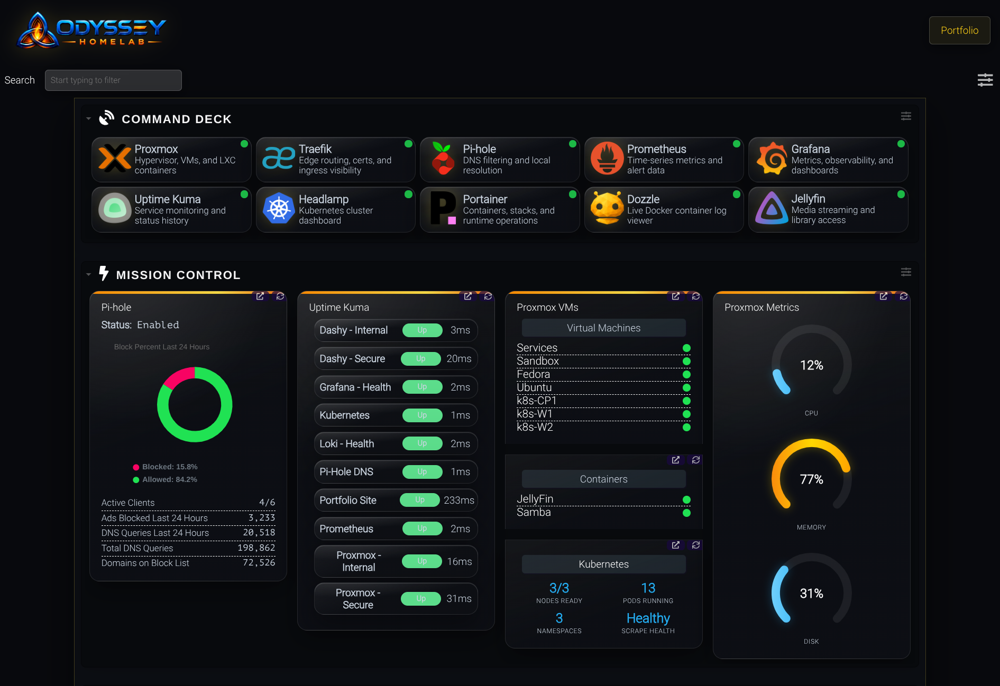
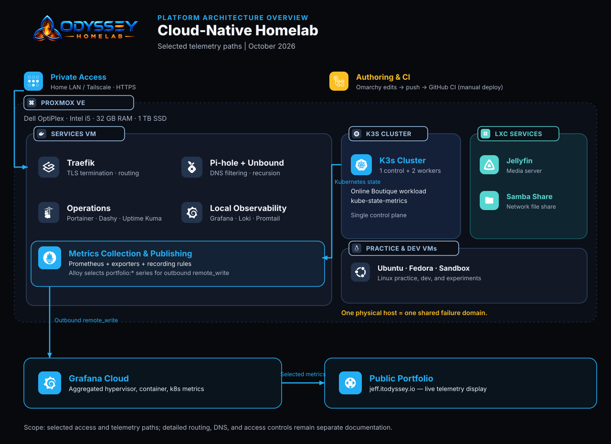
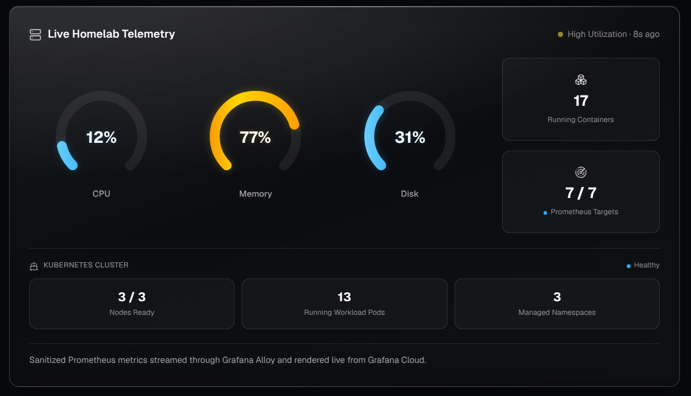

# Cloud-Native Homelab

[](https://github.com/Jeff-Fontenot/homelab/actions/workflows/ci.yml) [](https://github.com/Jeff-Fontenot/homelab/actions/workflows/cd.yml)

I designed and built this Proxmox-based platform for everyday services, application workloads, and infrastructure experimentation. It runs Docker Compose services alongside a three-node Kubernetes cluster, supported by private connectivity, DNS, TLS routing, centralized metrics and logs, and a custom operations dashboard. A Prometheus, Alloy, and Grafana Cloud pipeline publishes selected live host and Kubernetes telemetry to [my portfolio](https://jeff.itodyssey.io).

**Status: Operational · Active Development.** Core services, the dashboard, and portfolio telemetry are running. This repository captures selected configuration from the Services VM. GitHub Actions validates the Compose configuration on pushes to `main` and on pull requests. Automated deployment is being implemented; operational runbooks remain on the roadmap.



Dashboard capture: 2026-10-17. Screenshots show a point-in-time view of the running lab.

## Purpose and scope

The lab connects the systems behind a deployment: compute, DNS, private access, routing, metrics, and logs. I use it to practice operating those dependencies together and to investigate failures with evidence.

This repository documents the platform, selected configuration, and operational procedures. Application source and delivery pipelines belong in their own project repositories, including [Ops-Status](https://github.com/Jeff-Fontenot/ops-status) and [WakeTrail](https://github.com/it-odyssey/waketrail). Deploying Ops-Status into the lab remains future integration work.

## Architecture



[Edit the architecture diagram in Excalidraw](docs/diagrams/homelab-architecture.excalidraw). The drawing shows the platform and selected telemetry paths; it is not a complete network or firewall map.

The physical host is a Dell OptiPlex with an Intel i5, 32 GB RAM, and a 1 TB SSD.

All of these guests share one physical failure domain. The three-node Kubernetes cluster supports node and workload practice; it does not provide physical-host redundancy. Its single control-plane node is also a control-plane availability limit.

### Workload inventory

| Environment | Role |
| --- | --- |
| Services VM | Core Docker Compose services, routing, DNS, and monitoring |
| Sandbox VM | Application development and experiments |
| Fedora and Ubuntu VMs | Linux practice and desktop environments |
| k3s control plane | Kubernetes API and cluster control |
| Two k3s workers | Kubernetes workload execution |
| Jellyfin LXC | Media service |
| Samba LXC | File sharing |

The Services VM was previously named `System-Services`. A detailed inventory of guest names, resource allocations, versions, and persistence locations is planned.

### Service responsibilities

| Component | Responsibility |
| --- | --- |
| Docker Compose | Definition and operation of the services stack |
| Tailscale | Authenticated private connectivity for remote access |
| Traefik | Reverse proxying, service routing, and TLS termination |
| Pi-hole and Unbound | DNS filtering, local resolution, and recursive DNS |
| Dashy | Service links and operational widgets |
| Portainer | Container and stack administration |
| Prometheus | Metrics collection, queries, and recording rules |
| Node Exporter and cAdvisor | Linux host and container metrics |
| Pi-hole Exporter and Traefik metrics | DNS-service and reverse-proxy measurements |
| Proxmox VE Exporter | Hypervisor CPU, memory, and root-filesystem utilization |
| kube-state-metrics | Kubernetes object-state measurements |
| Grafana | Local metric dashboards |
| Loki and Promtail | Centralized logs and log collection; the Promtail configuration is included |
| Dozzle | Live Docker log viewing |
| Uptime Kuma | Configured availability checks and response times |
| Grafana Alloy | Collection of approved portfolio series and forwarding to Grafana Cloud |
| Google Online Boutique | Multi-service workload running on k3s |

The repository currently includes selected Services configuration. Alloy configuration, Kubernetes manifests/RBAC, and a complete version inventory still need to be captured. This is an operational reference for an existing lab; a fresh clone does not contain its persistent application data or credentials.

## Networking and access

Tailscale, DNS, and Traefik solve different parts of service access.

- **Connectivity:** Tailscale supplies the authenticated private remote path.
- **Name resolution:** Pi-hole provides local DNS behavior and filtering; Unbound performs recursive resolution. Cloudflare manages the public domain and supports DNS-based certificate validation where configured.
- **HTTP routing:** Traefik routes requests to configured backends and terminates TLS for service URLs.

Management interfaces are intended to remain private. Publishing telemetry does not require an inbound public route to Prometheus, Grafana, or Proxmox.

Proxmox is reachable through its friendly HTTPS URL without a browser certificate warning. The exact certificate and backend-routing arrangement still needs to be recorded. DNS behavior from LAN and Tailscale clients, direct LAN paths, ACLs or grants, and break-glass access also need explicit validation.

A successful request on the home LAN does not establish that remote access works. The runbook will record both paths and their dependencies.

## Observability

The documented metrics pipeline has five stages:

| Stage | What happens |
| --- | --- |
| Collect | Exporters expose host, container, proxy, DNS, and Kubernetes state |
| Evaluate | Prometheus scrapes targets and evaluates aggregate recording rules |
| Select | Alloy federates the approved `portfolio:*` series |
| Forward | Alloy sends metrics outbound to Grafana Cloud |
| Present | The portfolio displays the selected measurements |

Local Grafana dashboards and Loki logs support deeper investigation. Uptime Kuma supplies configured reachability and response-time checks. Those checks complement Prometheus scrape state.

### What the public card measures

| Measurement | Interpretation |
| --- | --- |
| Host CPU, memory, and disk | Proxmox hypervisor CPU, memory, and root-filesystem utilization, selected with `id="node/proxmox"` |
| Running containers | Count of cAdvisor `container_last_seen` series with `job="cadvisor"` and a nonempty image label; the rule is a series count rather than a direct Docker running-state query |
| Healthy/configured scrape targets | `sum(up)` compared with `count(up)` across Prometheus scrape targets; this measures metrics collection |
| Ready Kubernetes nodes | Count of nodes with Ready condition `true`, from the `kubernetes-state` job |
| Running pods | Running-phase pods excluding `kube-system`, `kube-public`, `kube-node-lease`, and `observability`; phase does not establish workload readiness |
| Namespace count | Active namespaces excluding `kube-system`, `kube-public`, and `kube-node-lease`; `observability` is included |

Counts and percentages change. The public display is operational evidence, not an SLO or an availability guarantee.



Telemetry capture: 2026-10-17.

### Recording rules and federation

The recording-rule file is included at [data/prometheus/portfolio-rules.yml](data/prometheus/portfolio-rules.yml), alongside [the Prometheus configuration](data/prometheus/prometheus.yml). The table above records the scopes in the committed rules. Alloy configuration and forwarding labels still need to be captured to complete the published pipeline reference.

An illustrative federation request for one approved metric is:

```bash
# Run on the services host when Prometheus is reachable at this address.
# Adjust the address to the verified local listener if necessary.
curl --fail --silent --show-error --get \
  'http://127.0.0.1:9090/federate' \
  --data-urlencode 'match[]=portfolio:scrape_health_percent'
```

The metric selector controls which series are requested. It does not strip labels. Recording-rule outputs, external labels, and forwarding relabeling must be checked so the public feed contains only approved measurements and labels. Credentials stay outside published examples.

## Operational dashboard

Dashy provides three views:

- **Command Deck:** Links to ten administrative and service interfaces.
- **Mission Control:** Pi-hole statistics, Uptime Kuma checks, Proxmox guest state and utilization, and Kubernetes state.
- **Incoming Transmissions:** Collapsible technical feeds.

The dashboard provides an entry point and a status overview. Deeper diagnosis happens in the relevant service, metrics, or logs. A VM running, a container running, a successful metrics scrape, and a successful application request are separate observations.

## Incident: Pi-hole exporter authentication

**Symptom:** The portfolio showed five of six scrape targets healthy.

**Investigation:** The Pi-hole exporter was receiving HTTP 401 responses after an authentication change. This was a metrics-collection failure; it did not by itself establish a DNS outage.

**Resolution:** A dedicated Pi-hole application password restored exporter access.

**Validation:** The Prometheus target became healthy, and the portfolio returned to six of six healthy scrape targets.

**Follow-up:** Record the exporter authentication settings without the secret, the rotation procedure, and the checks used after rotation.

```promql
up == 0
```

This query selects failed scrape targets for investigation. It is a diagnostic starting point, not the complete root-cause analysis.

(add screenshot of the healthy Pi-hole exporter target in Prometheus with credentials and identifying labels hidden)

A current healthy-state capture can accompany this incident record if historical evidence was not saved.

## Validation examples

These commands are reference checks for the running environment. The staged secret scan below has been run successfully; the other commands are documented checks, with fresh results still to be recorded.

On Services, from `~/homelab`:

```bash
# Check the Compose model without printing its resolved contents.
docker compose config --quiet

# Inspect container state. Application checks are still needed.
docker compose ps
```

With `promtool` installed, validate the included recording-rule file from the repository root:

```bash
promtool check rules data/prometheus/portfolio-rules.yml
```

Validate the full Prometheus configuration in its actual runtime environment so referenced rule paths and credential files resolve correctly. Configuration checks establish validity; target reachability and data delivery require separate checks.

From a machine with an authorized kubeconfig:

```bash
# -o wide includes additional node details such as addresses.
kubectl get nodes -o wide

# -A includes all namespaces.
kubectl get pods -A

kubectl get namespaces
```

Inspect workload readiness and relevant service responses in addition to resource counts. For public screenshots, use only the fields needed to demonstrate the result.

(add screenshot of all three k3s nodes Ready and the Online Boutique workload with identifying fields hidden)

## Repository organization

The Services checkout lives at `~/homelab`. Configuration and local application state currently share this directory; `.gitignore` includes specific configuration files under `data/` and excludes the remaining state.

| Path | Contents |
| --- | --- |
| [docker-compose.yml](docker-compose.yml) | Services stack definition |
| [compose.preview.yml](compose.preview.yml) | Local Dashy preview definition, prepared on Omarchy; add it in the same commit as this documentation |
| [.github/workflows/ci.yml](.github/workflows/ci.yml) | Automated Compose validation |
| [docs/diagrams/](docs/diagrams/) | Editable Excalidraw architecture source and exported diagrams |
| [docs/images/](docs/images/) | Point-in-time dashboard and portfolio screenshots |
| [dashy-conf.yml](dashy-conf.yml) | Operational dashboard configuration |
| [data/diun/diun.yml](data/diun/diun.yml) | DIUN configuration |
| [data/grafana-provisioning/datasources/prometheus.yml](data/grafana-provisioning/datasources/prometheus.yml) | Grafana datasource provisioning |
| [data/prometheus/prometheus.yml](data/prometheus/prometheus.yml) | Prometheus configuration |
| [data/prometheus/portfolio-rules.yml](data/prometheus/portfolio-rules.yml) | Portfolio recording rules |
| [data/promtail/config.yml](data/promtail/config.yml) | Promtail configuration |
| [data/traefik/dynamic.yml](data/traefik/dynamic.yml) | Traefik dynamic configuration |
| [data/unbound/unbound.conf](data/unbound/unbound.conf) | Reference Unbound configuration; its Compose bind mount is currently commented out |
| [icons/](icons/) | Dashboard branding assets |
| [patches/](patches/) | Dashy widget customizations |
| [.env.example](.env.example) | Environment-variable template |
| [secrets/README.md](secrets/README.md) | Local secret setup documentation |
| [.gitignore](.gitignore) | Credential and runtime-file exclusions |
| [scripts/check-secrets.sh](scripts/check-secrets.sh) | Automated scan of staged changes |

Local `.env` files, secret values, certificates/private keys, databases, logs, and other runtime files are excluded. Persistent application state requires a separate backup and restore process.

Additional architecture, inventory, networking, observability, recovery, and troubleshooting documents will be added as those procedures are recorded.

## Configuration workflow

Omarchy is the intended primary workspace for documentation and configuration. Services holds the operational checkout. GitHub Actions validates the Compose configuration and automatically deploys validated Dashy changes to Services over Tailscale and SSH, with container health verification.

Before each commit, stage the intended files and scan that snapshot:

```bash
git add .
./scripts/check-secrets.sh
git diff --cached --stat
```

The script runs Gitleaks in a temporary Docker container with a read-only repository mount, network access disabled, and detected secret values redacted. It examines staged changes. After editing a staged file, stage it again and rerun the check.

The initial staged configuration snapshot passed this scan on **2026-10-17**, with approximately **82.49 KB scanned and no leaks found**. An earlier manual review also reported no exposed secrets. Automated scanning complements manual review of credential handling.

### Continuous integration

[The CI workflow](.github/workflows/ci.yml) runs on pushes to `main` and on pull requests. A GitHub-hosted Ubuntu runner checks out the repository and runs:

```bash
docker compose --env-file .env.example config --quiet
```

This validates Compose syntax, supported configuration fields, and environment-variable interpolation using the example file. It does not start containers, exercise live credentials, validate Prometheus rule expressions, or establish application health.

On 2026-10-17, the check passed for the initial configuration, rejected an intentionally unsupported Compose property, and passed again after that test commit was reverted. Both pull-request and `main` push triggers were verified.

The normal workflow for this owner-operated lab is direct commits and pushes to `main`. Pull requests remain available for changes that benefit from a separate review thread.

### Local dashboard preview

Omarchy runs a Dashy-only preview using `compose.preview.yml`, pinned to the image digest used by the Services container. The preview mounts the local dashboard configuration, icons, and custom Vue widgets. Its Proxmox token comes from ignored `.env.preview`; Pi-hole and Uptime Kuma credentials are local ignored files under `secrets/`.

```bash
# Validate the preview definition without printing resolved credentials.
docker compose --env-file .env.preview -f compose.preview.yml config --quiet

# Start the preview on localhost:8081.
docker compose --env-file .env.preview -f compose.preview.yml up -d
```

The preview renders the dashboard layout. Some Proxmox/Kubernetes metrics and RSS content are not currently loading; those preview differences remain follow-up work. Layout changes can be inspected locally before a commit. Changes to the patched Vue components require rebuilding/restarting the preview process.

### Continuous delivery

Pushes to main trigger Compose validation. After successful validation, the CD workflow connects to Services over Tailscale and SSH, applies the validated commit, and recreates Dashy when its configuration, assets, patches, or Compose definition change. Documentation-only updates synchronize the checkout and verify Dashy’s health without restarting it. Deployment is currently scoped to Dashy; rollback documentation and testing remain follow-up work.

## Current limitations

- One physical host and one k3s control-plane node remain failure points.
- Backup coverage, offsite copies, and tested restore procedures are not yet documented. This draft makes no recovery-time or recovery-point claim.
- Exact DNS, TLS, LAN-access, and remote-access paths need a recorded validation.
- Monitoring coverage, retention, alert delivery, and the full log-collection path still need documentation.
- Dashboard and portfolio layouts need a final mobile review.
- Infrastructure provisioning and service configuration are not yet fully automated.
- A successful scrape, node Ready state, or pod Running phase is narrower evidence than end-to-end application health.

## Roadmap

### Documentation and operations backlog

- [x] Capture selected Services configuration with credentials and runtime state excluded.
- [x] Add a reusable staged secret scan and complete the initial scan.
- [ ] Capture Alloy configuration and Kubernetes manifests/RBAC.
- [ ] Record a verified guest and service inventory.
- [x] Add an editable platform/telemetry architecture diagram.
- [ ] Validate and document detailed LAN, remote-access, DNS, and firewall paths.
- [x] Add a dashboard screenshot and link the deployed recording rules.
- [x] Add a screenshot of the portfolio telemetry section.
- [x] Document the Pi-hole exporter authentication incident.
- [ ] Record additional operational repairs as reusable runbooks.
- [ ] Record backup coverage and test a recovery procedure.
- [x] Add automated Compose configuration validation and verify pass/fail/recovery behavior.
- [x] Implement and verify the first Dashy deployment with health checks.
- [ ] Document and test the Dashy rollback procedure.
- [ ] Verify repository and portfolio links.

### Later improvements

- Tested image pinning and controlled update/rollback procedures.
- Backup automation and an offsite recovery target.
- More focused alerting and service-level checks.
- Repeatable configuration through Ansible and infrastructure provisioning where useful.
- Additional Kubernetes workload and resource dashboards.
- Ops-Status deployment and its separate application-delivery workflow.

## References

- [Live portfolio telemetry](https://jeff.itodyssey.io)
- [Prometheus federation](https://prometheus.io/docs/prometheus/latest/federation/)
- [PromQL operators](https://prometheus.io/docs/prometheus/latest/querying/operators/)
- [Docker Compose configuration validation](https://docs.docker.com/reference/cli/docker/compose/config/)
- [kubectl get](https://kubernetes.io/docs/reference/kubectl/generated/kubectl_get/)


